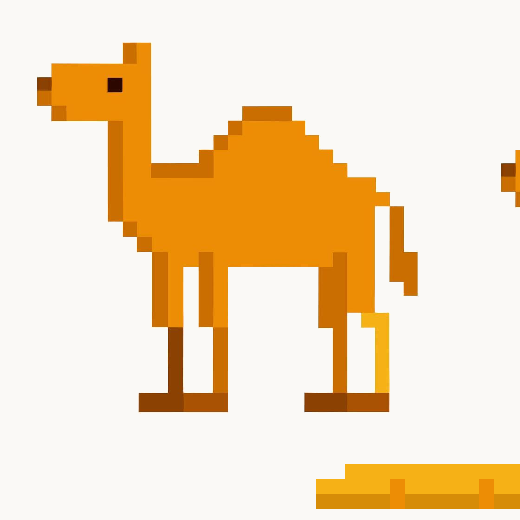

  

    <a class="back-link" href="/teaching/">← Teaching</a>
    
      <a class="jump-link" href="#notes">Lecture notes ↓</a>
      <a class="jump-link" href="#discussions">Discussions ↓</a>
      <a class="jump-link" href="#simulations">Simulations ↓</a>
    
  

  <h4><strong>Data Analytics Workshop</strong></h4>
  

  
AS.110.100, Johns Hopkins pre-college program. Developed Spring 2023; taught Summers 2023–2026

  
A two-week, fully online and asynchronous course for high school students. Working in small groups,
  students choose a real data set of their own (around a thousand rows or more), then clean,
  hypothesize, visualize it, and finish by presenting what they found. Along the way we will discuss the mathematics underneath: summary statistics, probability, distributions, and the basics of
  hypothesis testing and regression. All of the hands-on work happens in Microsoft Excel, and no background
  beyond some algebra is assumed.

  <ul class="syllabus-list">
    <li><strong>Describing data:</strong> sets, functions, and modeling; sigma notation; mean, median, mode,
    quartiles, variance, standard deviation, and the standard error of the mean; outliers and cleaning a data set.</li>
    <li><strong>Randomness and distributions:</strong> data as random variables, sampling, discrete and continuous
    distributions, the uniform and normal distributions, independence, conditional probability, and expected value.</li>
    <li><strong>Asking questions of data:</strong> forming meaningful hypotheses, correlation versus causation,
    choosing the right visual, regression, and the ethics and misuse of statistics.</li>
    <li><strong>Excel:</strong> formatting and formulas, sampling, histograms, bar charts with error bars, and
    scatterplots, practiced in four guided worksheets and used throughout the group project.</li>
  </ul>

  <h4><strong>Lecture Notes</strong></h4>
  

  
Typed notes for each day's lectures. 

  <!-- To add a day: copy a note-row into its week's folder-body and point it at assets/Data_Analytics_Workshop/notes/day_N.pdf/.zip.
       Anything under assets/Data_Analytics_Workshop/admin/ is git-ignored, so keep public files out of it. -->

  

    

      
      Week 1: Data, Distributions, and Questions
      Days 1–5
    

    

    

      Day 1 - Sets, Functions, and Sigma Notation
      

        <a class="pdf-btn" href="/assets/Data_Analytics_Workshop/notes/day_1.pdf" target="_blank">.pdf</a>
        <a class="pdf-btn" href="/assets/Data_Analytics_Workshop/notes/day_1.zip" target="_blank">.zip</a>
      

    

    

      Day 2 - Data, Sampling, and Statistics
      

        <a class="pdf-btn" href="/assets/Data_Analytics_Workshop/notes/day_2.pdf" target="_blank">.pdf</a>
        <a class="pdf-btn" href="/assets/Data_Analytics_Workshop/notes/day_2.zip" target="_blank">.zip</a>
      

    

    

      Day 3 - Distributions and Outliers
      

        <a class="pdf-btn" href="/assets/Data_Analytics_Workshop/notes/day_3.pdf" target="_blank">.pdf</a>
        <a class="pdf-btn" href="/assets/Data_Analytics_Workshop/notes/day_3.zip" target="_blank">.zip</a>
      

    

    

      Day 4 - Center, Spread, and Standard Error
      

        <a class="pdf-btn" href="/assets/Data_Analytics_Workshop/notes/day_4.pdf" target="_blank">.pdf</a>
        <a class="pdf-btn" href="/assets/Data_Analytics_Workshop/notes/day_4.zip" target="_blank">.zip</a>
      

    

    

      Day 5 - Questions, Hypotheses, and Correlation
      

        <a class="pdf-btn" href="/assets/Data_Analytics_Workshop/notes/day_5.pdf" target="_blank">.pdf</a>
        <a class="pdf-btn" href="/assets/Data_Analytics_Workshop/notes/day_5.zip" target="_blank">.zip</a>
      

    

    

  

  

    

      
      Week 2: Probability, Visuals, and Expected Value
      Days 6–8
    

    

    

      Day 6 - Probability and Conditional Probability
      

        <a class="pdf-btn" href="/assets/Data_Analytics_Workshop/notes/day_6.pdf" target="_blank">.pdf</a>
        <a class="pdf-btn" href="/assets/Data_Analytics_Workshop/notes/day_6.zip" target="_blank">.zip</a>
      

    

    

      Day 7 - Visualizing Results
      

        <a class="pdf-btn" href="/assets/Data_Analytics_Workshop/notes/day_7.pdf" target="_blank">.pdf</a>
        <a class="pdf-btn" href="/assets/Data_Analytics_Workshop/notes/day_7.zip" target="_blank">.zip</a>
      

    

    

      Day 8 - Expected Value
      

        <a class="pdf-btn" href="/assets/Data_Analytics_Workshop/notes/day_8.pdf" target="_blank">.pdf</a>
        <a class="pdf-btn" href="/assets/Data_Analytics_Workshop/notes/day_8.zip" target="_blank">.zip</a>
      

    

    

  

  

    
Collected Notes

    

      All Lecture Notes (Days 1–8)
      

        <a class="pdf-btn" href="/assets/Data_Analytics_Workshop/notes/lecture_notes_all.pdf" target="_blank">.pdf</a>
        <a class="pdf-btn" href="/assets/Data_Analytics_Workshop/notes/lecture_notes_all.zip" target="_blank">.zip</a>
      

    

    

      Excel Notes
      

        <a class="pdf-btn" href="/assets/Data_Analytics_Workshop/notes/excel_notes.pdf" target="_blank">.pdf</a>
        <a class="pdf-btn" href="/assets/Data_Analytics_Workshop/notes/excel_notes.zip" target="_blank">.zip</a>
      

    

  

  <h4><strong>Discussions</strong></h4>
  

  
Discussion boards run alongside the project. Each asks for an initial post and replies to classmates a day later.

  

    <!-- Hidden while the Pixel Explorer is broken; uncomment to restore.
    

      Day 2 <strong>Data Visualization</strong>
        A photo is a grid of red, green, and blue values. Histograms, bar charts, and scatter plots of those pixel values introduce what each kind of chart is good for.
      
      

        <a class="pdf-btn" href="/widgets/pixel-explorer/">Pixel Explorer</a>
      

    

    -->

    

      Day 8 <strong>Back-Breaking Straws and Expected Value</strong>
        Straws weighing 0 to 20 lb go on a camel until the load passes 100 lb. How much does the final straw weigh on average?
      
      

        <a class="pdf-btn" href="/widgets/camel-straw/">Simulator</a>
      

    

  

  <h4><strong>Simulations</strong></h4>
  

  
Interactive tools built for the course's discussions. They run in the browser; nothing to install.

  

    <!-- Template for a new simulation card. The app itself is a widget
         (widgets/<name>.md + widgets/<name>_code.html, see CLAUDE.md);
         a square thumbnail goes in widgets/images/.

    <a class="gallery-card" href="/widgets/NAME/">
      

      Title
      Discussion N
    </a>
    -->

    <a class="gallery-card" href="/widgets/camel-straw/">
      

      The Straw That Broke the Camel's Back
      Expected value · Discussion 5
    </a>

    <!-- Hidden while the Pixel Explorer is broken; uncomment to restore.
    <a class="gallery-card" href="/widgets/pixel-explorer/">
      

      Pixel Data Explorer
      Data visualization · Discussion 2
    </a>
    -->

  

